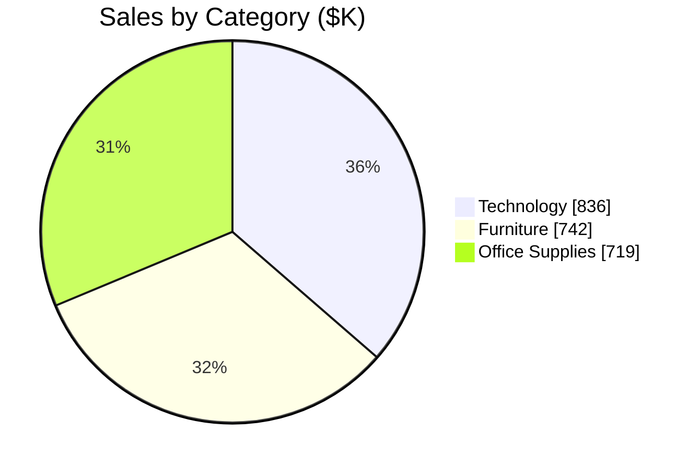
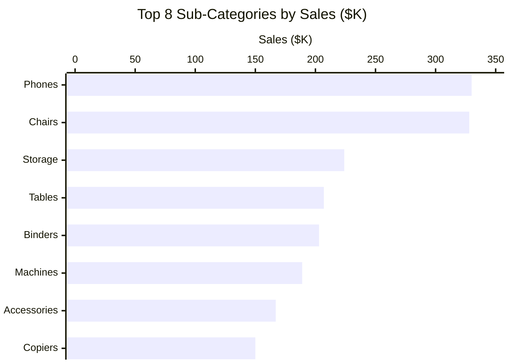

<div align="center">



<br/>

[](https://git.io/typing-svg)


[**🖥️ Preview**](#%EF%B8%8F-dashboard-preview) &nbsp;•&nbsp; [**✨ Features**](#-key-features) &nbsp;•&nbsp; [**📊 Insights**](#-key-insights) &nbsp;•&nbsp; [**🧮 KPIs**](#-kpis) &nbsp;•&nbsp; [**🧷 Pivots**](#-excel-pivot-tables) &nbsp;•&nbsp; [**🚀 Quick Start**](#-quick-start) &nbsp;•&nbsp; [**👨‍💻 Author**](#-author)

</div>

---

## 🎯 Project Overview

An interactive **Power BI** dashboard built on the classic *Sample Superstore* dataset. It turns nearly 10,000 order lines into clear answers about **sales, profit, quantity sold, product categories, regions and seasonality**, so business users can see what drives revenue and where money is being lost.

---

## 🖥️ Dashboard Preview

<div align="center">


<sub>Supermarket-themed interface with a filter panel that cross-filters every visual.</sub>

</div>

---

## 📈 At a Glance

<div align="center">

| 💰 **$2.30M** | 📊 **$286.4K** | 📐 **12.5%** | 📦 **37,873** | 🛒 **5,009** | 👥 **793** |
|:---:|:---:|:---:|:---:|:---:|:---:|
| Total Sales | Total Profit | Profit Margin | Units Sold | Orders | Customers |

</div>

---

## ✨ Key Features

| | Feature | Description |
|:--:|---|---|
| 🎛️ | **5 Smart Slicers** | Filter by Category, Year, State, Sub-Category and Region |
| 🔢 | **KPI Cards** | Total Sales, Total Profit, Profit Margin and Total Quantity |
| 🧷 | **Excel Pivot Tables** | 5 pivot tables by region, category, segment, sub-category and month |
| 📊 | **Sales & Profit by Year** | Compare yearly performance from 2014 to 2017 |
| 🍩 | **Sales by Category** | Donut chart of Technology, Furniture and Office Supplies |
| 🏆 | **Top 8 Sub-Categories** | Ranked bar chart of best sellers |
| 📈 | **Monthly Trend** | Area chart of monthly sales and profit |
| 🎨 | **Immersive Design** | Retail background, custom icons and a blue-gold palette |

---

## 📊 Key Insights

### 📅 Sales Grew Every Year Since 2015

```mermaid
xychart-beta
    title "Sales vs Profit by Year (in $K)"
    x-axis [2014, 2015, 2016, 2017]
    y-axis "Amount ($K)" 0 --> 800
    bar [484, 471, 609, 733]
    bar [50, 62, 82, 93]
```



> Sales rose about **51%** from 2014 to 2017, and profit nearly doubled.

### 🍩 Category Share of Sales



### 🏆 Top 8 Sub-Categories by Sales



<details>
<summary><b>⚠️ Where the business loses money (click to expand)</b></summary>
<br/>

| Area | Profit | Note |
|---|--:|---|
| 🪑 **Furniture margin** | only **2.5%** | Highest-selling group with the weakest margin, versus ~17% for Technology and Office Supplies |
| 📉 **Tables** | **-$17,725** | Sells $207K but loses money |
| 📚 **Bookcases** | **-$3,473** | Loss-making sub-category |
| 📎 **Supplies** | **-$1,189** | Loss-making sub-category |
| 🗺️ **Texas** | **-$25,729** | Biggest loss among states |
| 🗺️ **Ohio** | **-$16,971** | Second-biggest state loss |
| 🗺️ **Pennsylvania** | **-$15,560** | Third-biggest state loss |

</details>

<details>
<summary><b>🌎 Regional performance (click to expand)</b></summary>
<br/>

| Region | Sales | Profit | Margin |
|---|--:|--:|--:|
| 🧭 West | $725K | $108K | 14.9% |
| 🧭 East | $679K | $92K | 13.5% |
| 🧭 Central | $501K | $40K | 7.9% |
| 🧭 South | $392K | $47K | 11.9% |

</details>

<details>
<summary><b>👥 Customer segments (click to expand)</b></summary>
<br/>

| Segment | Sales | Share |
|---|--:|---|
| 🧑 Consumer | $1.16M | `██████████` 51% |
| 🏢 Corporate | $706K | `██████` 31% |
| 🏠 Home Office | $430K | `████` 19% |

</details>

> 💡 **Takeaway:** Technology drives the most profit, West is the strongest region, and discounting or pricing on **Tables, Bookcases and Furniture overall** is the biggest opportunity to improve margin.

---

## 🧮 KPIs

Four headline KPIs sit on the Excel `dash` sheet and as cards in Power BI.

| KPI | Value | Excel formula | DAX measure |
|---|--:|---|---|
| 💰 **Total Sales** | **$2,297,201** | `=SUM(Sales)` | `Total Sales = SUM('Sample - Superstore'[Sales])` |
| 📊 **Total Profit** | **$286,397** | `=SUM(Profit)` | `Total Profit = SUM('Sample - Superstore'[Profit])` |
| 📐 **Profit Margin** | **12.47%** | `=Profit / Sales` | `Profit Margin = DIVIDE([Total Profit], [Total Sales])` |
| 📦 **Total Quantity** | **37,873** | `=SUM(Quantity)` | `Total Quantity = SUM('Sample - Superstore'[Quantity])` |

<details>
<summary><b>➕ Extra KPIs you can add (click to expand)</b></summary>
<br/>

| KPI | Value | DAX |
|---|--:|---|
| 🛒 Total Orders | 5,009 | `DISTINCTCOUNT([Order ID])` |
| 💵 Avg Sales per Order | $458.61 | `DIVIDE([Total Sales], [Total Orders])` |
| 🏷️ Avg Discount | 15.6% | `AVERAGE([Discount])` |
| 🚀 Sales Growth (YoY) | +20.3% (2016 to 2017) | `DIVIDE([Sales CY] - [Sales PY], [Sales PY])` |

</details>

---

## 🧷 Excel Pivot Tables

The `PIVOT` sheet in the workbook holds **5 pivot tables** that feed the dashboard. Below are the same views with sales, profit and margin.

### 🌎 By Region

| Region | Sales | Profit | Margin |
|---|--:|--:|--:|
| West | $725,458 | $108,418 | 14.9% |
| East | $678,781 | $91,523 | 13.5% |
| Central | $501,240 | $39,706 | 7.9% |
| South | $391,722 | $46,749 | 11.9% |
| **Grand Total** | **$2,297,201** | **$286,397** | **12.5%** |

### 🗂️ By Category

| Category | Sales | Profit | Margin | Qty |
|---|--:|--:|--:|--:|
| Technology | $836,154 | $145,455 | 17.4% | 6,939 |
| Furniture | $741,999 | $18,451 | 2.5% | 8,028 |
| Office Supplies | $719,047 | $122,491 | 17.0% | 22,906 |

### 👥 By Segment

| Segment | Sales | Profit | Margin |
|---|--:|--:|--:|
| Consumer | $1,161,401 | $134,119 | 11.5% |
| Corporate | $706,146 | $91,979 | 13.0% |
| Home Office | $429,653 | $60,299 | 14.0% |

<details>
<summary><b>🏷️ By Sub-Category (click to expand)</b></summary>
<br/>

| Sub-Category | Sales | Profit | Margin |
|---|--:|--:|--:|
| Phones | $330,007 | $44,516 | 13.5% |
| Chairs | $328,449 | $26,590 | 8.1% |
| Storage | $223,844 | $21,279 | 9.5% |
| Tables | $206,966 | 🔴 -$17,726 | -8.6% |
| Binders | $203,413 | $30,222 | 14.9% |
| Machines | $189,239 | $3,385 | 1.8% |
| Accessories | $167,380 | $41,937 | 25.1% |
| Copiers | $149,528 | $55,618 | 37.2% |
| Bookcases | $114,880 | 🔴 -$3,473 | -3.0% |
| Appliances | $107,532 | $18,138 | 16.9% |
| Furnishings | $91,705 | $13,059 | 14.2% |
| Paper | $78,479 | $34,054 | 43.4% |
| Supplies | $46,674 | 🔴 -$1,189 | -2.5% |
| Art | $27,119 | $6,528 | 24.1% |
| Envelopes | $16,476 | $6,964 | 42.3% |
| Labels | $12,486 | $5,546 | 44.4% |
| Fasteners | $3,024 | $950 | 31.4% |

</details>

<details>
<summary><b>📅 Monthly trend pivot</b></summary>
<br/>

A pivot table by `Year-Month` (2014-01 to 2017-12) powers the **Monthly Sales and Profit** area chart on the dashboard.

</details>

---

## 🗂️ Dataset

<details open>
<summary><b>Source & structure</b></summary>
<br/>

- **File:** `Sample - Superstore.xlsx` (sheets: data, dashboard sheet and pivot)
- **Size:** **9,994 rows × 23 columns**, covering **2014–2017**, with 49 states in 4 regions
- **Key columns:** Order ID · Order Date · Ship Mode · Customer · Segment · State · Region · Category · Sub-Category · Sales · Quantity · Discount · Profit
- **Added columns:** `year` and `month` for time analysis

</details>


---

## 🚀 Quick Start

```bash
git clone https://github.com/<your-username>/Superstore-Sales-Dashboard.git
```

1. Install [Power BI Desktop](https://powerbi.microsoft.com/desktop/) (free, Windows).
2. Open `dashboard/superstore.pbit`.
3. When asked, point the data source to `data/Sample - Superstore.xlsx`, then click **Load**.
4. Use the filter panel on the left to explore.

<details>
<summary><b>📁 Project structure</b></summary>

```text
Superstore-Sales-Dashboard/
├── README.md
├── data/
│   └── Sample - Superstore.xlsx
├── dashboard/
│   └── superstore.pbit
└── images/
    ├── banner.svg
    └── dashboard.png
```

</details>

---

## 🔮 Roadmap

- [x] Clean and prepare the Superstore data
- [x] Build KPI cards, trends and slicers
- [ ] Add a Profit by State map
- [ ] Add discount vs profit analysis
- [ ] Add customer and shipping performance page
- [ ] Publish to Power BI Service

---

## 👨‍💻 Author

<div align="center">

### **Pratham Madival**

*Aspiring Data Analyst | Power BI | Excel | SQL | Python*

[](https://github.com/your-username)
[](https://linkedin.com/in/your-profile)

⭐ **If you like this project, give it a star!** ⭐

<sub>Dataset: Sample Superstore. Educational project.</sub>


</div>
